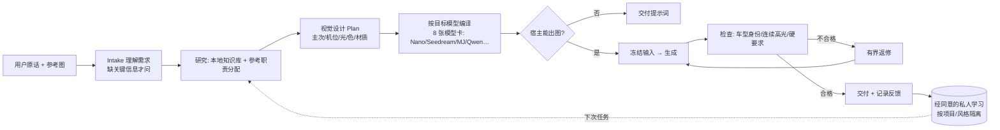

# HEX · 给宿主 AI 补审美的出图 Agent

[](https://github.com/jasperhex45-design/hex-agent-beta/actions/workflows/beta-package-check.yml)

**先问清，再设计，最后按目标模型写提示词。从汽车摄影开始。**

HEX 运行在你已有的 AI 助手（宿主）里，由创作方法、模型资料和可选的 Python 流程工具组成，**不是独立的生图模型**。

<!-- 首屏作品图：待补（计划任务 7）。只放一张自产、可公开的图：输入原话 → HEX 方案摘要 → 成片（注明模型）。 -->

## 它解决什么问题

1. **宿主 AI 的审美偏弱。** 直接让对话模型写提示词，常得到“AI 味”的默认画面。HEX 先把用途、主次、机位、光、色、材质想清楚，再写字。
2. **不同模型写法不同。** Nano、Seedream、Midjourney、Qwen 等对提示词的要求不一样，用户通常不会逐个去学。HEX 用 8 张带来源的模型卡，把同一份方案分别编译成各模型的写法。
3. **改图容易丢身份。** 改车漆却把轮毂、灯组、车身比例也改了。HEX 把“身份图 / 风格图 / 编辑底图”的职责分开，并在交付前检查保留项。

## 架构



### 为什么是 Agent，而不是一个 Skill

| 一个 Skill 做不到的 | HEX 怎么做 | 在仓库里的证据 |
| --- | --- | --- |
| 多轮状态：问了什么、答了什么、做到哪一步，中断后接着做 | 任务状态、问询记录、恢复 | `liu_agent/resume.py`、`liu_agent/run_status.py`、`schemas/Need.schema.json` |
| 一份方案，按不同目标模型分别编译 | 8 张模型卡 + 编译与 preflight | `knowledge/models/`、`knowledge/model-prompts/`、`liu_agent/generation_spec.py` |
| 出图后自查，不合格就有界返修，不偷偷降级 | 质量检查、交付评审、有界返修 | `liu_agent/quality_review.py`、`liu_agent/delivery_review.py`、`liu_agent/bounded_repair.py` |
| 越用越懂你，但不串项目 | WORK 私人学习：经同意、按范围隔离、可撤回 | `.agents/skills/hex-work-learning/SKILL.md`、`liu_agent/work_learning.py` |

**Skill 是一份说明书；HEX 是按说明书干活、会记账、会返工的执行者。** 汽车 Skill 是 HEX 加载的领域模块之一。

## 快速开始

```sh
git clone https://github.com/jasperhex45-design/hex-agent-beta.git && cd hex-agent-beta
sh scripts/bootstrap.sh          # Windows: .\scripts\bootstrap.ps1
.venv/bin/python -m hex_agent demo --out outputs/demo   # 离线合成示例，不调用任何模型
```

日常使用推荐从 [Releases](https://github.com/jasperhex45-design/hex-agent-beta/releases) 导入标准 `HEX-Skill` 包，然后在宿主里说“用 HEX……”。详见[安装与检查](docs/INSTALL.md)和[跨宿主能力](docs/HOST_PORTABILITY.md)。

### 装好之后怎么用

1. **选宿主。** 以 Codex 为例：把 Releases 中的 `HEX-Skill-*.zip` 按本地技能导入（保留 `hex/` 目录），然后直接说“用 HEX 给这台车做一张……”。其他宿主见[跨宿主能力](docs/HOST_PORTABILITY.md)。
2. **装运行依赖。** Skill 包里的流程工具要求宿主使用的 Python（3.11+）装有 `requirements.txt` 中的精确版本：`pip install httpx==0.28.1 pydantic==2.13.4 Pillow==12.3.0`；版本不符时 `python hex/scripts/hex.py --skill-doctor` 会报告 `"ready": false`。
3. **只要提示词也可以。** 没有 Python 或生图工具时，HEX 仍可读方法与模型资料，交付方案和提示词；操作细节见 [docs/RUNTIME.md](docs/RUNTIME.md)。

## 示例：怎么开口

> 用 HEX。以这张图为编辑输入，保留车身比例、机位和轮毂，只调整车漆质感。先看参考并确认本次模型，再执行，最后用结果图指出是否做到。

不需要填写内部模板。缺少影响结果的信息时，HEX 才会问；没有生图工具时，先交付方案或提示词。汽车方法见[汽车摄影说明](docs/CAR_PHOTOGRAPHY_MVP.md)，输入样例见 [`examples/vehicle-brief.json`](examples/vehicle-brief.json)。

## 局限与边界

- **画质不是卖点。** HEX 改善的是需求理解、方案和提示词；单张画质取决于目标模型。本仓库尚未做 HEX 与宿主直写提示词的成图对照测试。
- **已验证范围有限。** 当前优先验证汽车静图、有界改图和模型提示词。人物、平面设计等方向未做实图验证，公开树里也不再提供它们的示例。
- **执行能力取决于宿主。** 模型、账户与生成额度来自你自己的宿主或已连接服务；能导入 Skill 不等于文件、看图、Python 和生图工具都已接通。离线 demo 是合成示例，不是模型生成效果。
- **私人学习默认关闭。** 经同意开启，可撤回、可停用；不训练权重，没有离线后台。私人档案只做本机逻辑隔离，不是账号鉴权或操作系统级隐私保护。
- **反馈请只提交有权公开的素材。** 在 [Issues](https://github.com/jasperhex45-design/hex-agent-beta/issues/new/choose) 写清原始需求、目标模型、实际结果和最关键的一处差距；不要上传客户保密图片、个人信息、密钥或私人档案。

## 项目说明

- 开发在私有库进行，本仓库是公开发行版；版本见 [`pyproject.toml`](pyproject.toml)，变化见 [CHANGELOG](CHANGELOG.md)。
- 开发中使用了 AI 编码 Agent（Codex），部分提交的作者因此显示为 Codex。
- Skill 在 `.agents/skills/` 下；内部包名 `liu_agent` 与 `cl_hex` 为历史兼容保留，对外名称统一为 HEX。
- 文档：[操作、续改与恢复](docs/RUNTIME.md) · [共用创作方法](docs/HEX_CORE_METHOD.md) · [私人学习](docs/WORK_LEARNING.md) · [模型提示词资料](knowledge/model-prompts/README.md) · [参与方式](CONTRIBUTING.md)

<!-- 作品集链接：待补（计划任务 1/10 确认后填写）。只放作品集链接，不放手机号。 -->

## 许可与致谢

有权许可的自有源码和文档采用 [CC BY-NC 4.0](LICENSE)；第三方来源与适用范围见 [THIRD_PARTY_NOTICES.md](THIRD_PARTY_NOTICES.md)。公开下载不改变许可条款，也不为用户素材或模型服务提供额外授权。
